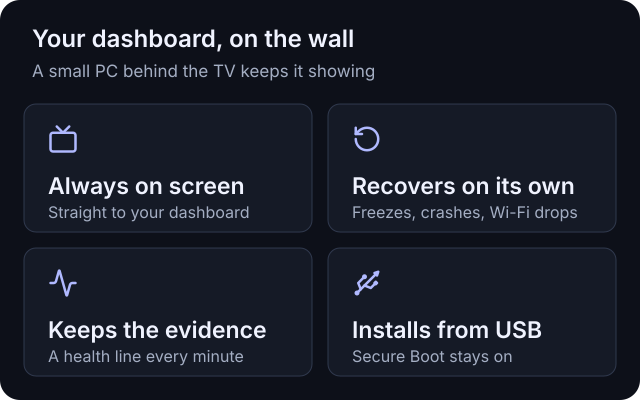

# NoticeTV

[](docs/images/noticetv-hero.jpg)

## Your dashboard. On the wall.

**A small PC behind any TV that keeps your web dashboard on screen, around the clock.**
It starts straight into your dashboard, recovers on its own and installs from a USB stick.

[](LICENSE)
[](https://www.debian.org/)
[](https://dietpi.com/)
[](https://www.chromium.org/)
[](docs/building.md#the-installer)



- **Always on screen.** Straight from power-on into your dashboard in a full-screen browser,
  behind the NoticeTV boot screen, with no console text on the way.
- **Recovers on its own.** A hardware watchdog reboots a frozen box, the kernel reboots after a
  crash, the kiosk restarts if the browser quits, and Wi-Fi reconnects after a real outage.
- **Keeps the evidence.** Logs stay on disk, with a line of health every minute, so a problem
  can be diagnosed after the fact.
- **Stays patched.** Debian security updates install unattended, with a reboot at 04:30 when one
  needs it.
- **Runs fanless.** An optional power profile caps the processor's power so a passively cooled
  box holds a steady temperature.

It shows any web page: the NoticeOS Wall, Grafana, Home Assistant or your own. **NoticeTV OS**
is a layer on [DietPi](https://dietpi.com), a lightweight Debian.

Status: early. NoticeTV OS runs the maintainer's wall display.

## Install


From the latest [release](https://github.com/notice-cx/NoticeTV/releases):

1. Write `noticetv-installer-<version>-x86_64.img` to a USB stick of 2 GB or more, with
   [balenaEtcher](https://etcher.balena.io) or Raspberry Pi Imager.
2. Plug the stick into the mini PC, turn it on and choose the USB stick in its boot menu (often
   F7, F11, F12 or Esc while it starts). Secure Boot can stay on.
3. Check the drive it names and press Enter. Type your Wi-Fi network and its password (or press
   Enter to use a network cable), then your dashboard's address. When it is done, remove the
   stick: the box restarts into NoticeTV, showing your dashboard.

The release also has the **NoticeTV OS image** the installer writes,
`noticetv-os-<version>-x86_64.img.xz`, for writing to a drive directly.
[docs/hardware.md](docs/hardware.md) lists the boxes NoticeTV has run on.

**On a box already running DietPi**, with SSH enabled, from a computer with this repository:

```sh
scripts/install-over-ssh.sh root@<the box's IP address>
ssh root@<the box's IP address> reboot
```

## Choose what it shows


The installer asks for the Wi-Fi network and the dashboard. To change them later, start the box
from the installer stick again and choose **Change its Wi-Fi and dashboard**: nothing else on the
box is touched.


On a box you reach over SSH, every setting is in `/etc/noticetv/noticetv.conf`; run
`/opt/noticetv/install.sh` there to apply it. Each one, with its default, is in
[os/noticetv.conf.example](os/noticetv.conf.example). `install.sh` is safe to run again at any
time, for example after pulling a newer version.

## The status bar


## When something goes wrong

[docs/troubleshooting.md](docs/troubleshooting.md): reading the health log, finding out why the
box rebooted, seeing the boot messages behind the splash.

## Building it

[docs/building.md](docs/building.md): how the NoticeTV OS image and its installer are built, on
GitHub or your own machine, and tested.

## License

NoticeTV is licensed under the [GNU AGPL v3](LICENSE). The Stack Sans Notch and Inter fonts in
`brand/fonts` are licensed under the SIL Open Font License 1.1, and the
[Lucide](https://lucide.dev) icons in `brand/icons` under the ISC License. The hero's
photograph is from [notice.cx](https://www.notice.cx).
