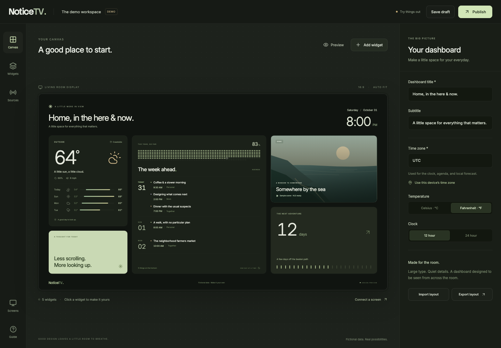

# NoticeTV

**A little more in view.**

NoticeTV is a self-hosted dashboard for the screen in your room. Bring together the weather,
your plans, a live video stream, and the things worth looking up for. Arrange it in a browser,
preview the whole screen, and publish when it feels right.



## The dashboard

- **A visual editor.** Add widgets, choose their sizes, reorder them, and preview a 16:9 display.
- **Weather.** Search for a location and connect current conditions and a five-day forecast from
  [Open-Meteo](https://open-meteo.com/).
- **HLS video.** Connect a browser-accessible `.m3u8` stream. Playback starts muted, fits its
  widget, and retries after interruptions. Uses native HLS where available and hls.js elsewhere.
- **An agenda, notes, countdowns, and world clocks.** Enter plans in NoticeTV, keep a thought in
  view, or see the time somewhere else.
- **Drafts and publishing.** Save work without changing the TV. Connected displays pick up a
  publication within ten seconds and retain the running view during a server interruption.
- **Screen pairing.** A single-use code connects a screen with viewing access. Editing requires
  the server's editor key.
- **Portable layouts.** Import and export a versioned JSON document.

The `/demo` workspace uses fictional data and an original illustrated scene; it starts without external
data requests. Real dashboards start with empty connections. The agenda is entered manually;
external calendar sync and Home Assistant connections are not implemented in this version.

## Run locally

Requires **Node.js 22.12 or newer** and npm. In the `app/` directory:

```sh
npm ci
npm run dev
```

Open **http://localhost:3000/demo** to explore the editor. To save a real dashboard, open
**http://localhost:3000/** and enter the key printed by this command in another terminal:

```sh
npm run access-key
```

The server binds to loopback by default. For Docker, access from another device, HTTPS,
configuration, and the production build, see **[the dashboard guide](app/README.md)**.

## The TV appliance

**NoticeTV OS** turns an Intel or AMD mini PC into an unattended display. It boots straight into
a web dashboard, recovers from browser and network problems, and installs Linux security updates.
It can show a NoticeTV dashboard or any other web page.

The dashboard app is currently installed separately; the OS image does not bundle it. Existing
OS installations and image releases keep their existing behavior.

See **[the OS installation guide](docs/operating-system.md)** for the USB installer, hardware
requirements, settings, and recovery behavior. Installing the OS erases the selected drive.

## Contributing

NoticeTV is early software. Contributions should include clear behavior, appropriate local
verification, and documentation. Read **[CONTRIBUTING.md](CONTRIBUTING.md)** for the development
workflow and **[AGENTS.md](AGENTS.md)** for repository conventions.

## License

NoticeTV is free and open source under the **[GNU AGPL v3](LICENSE)**. Bundled fonts and
dependencies retain their respective licenses; see [third-party notices](app/THIRD_PARTY_NOTICES.md).
