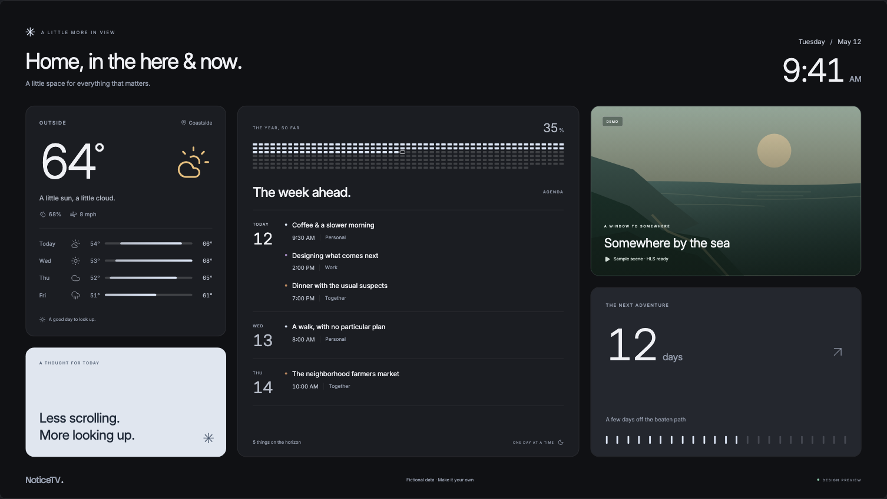
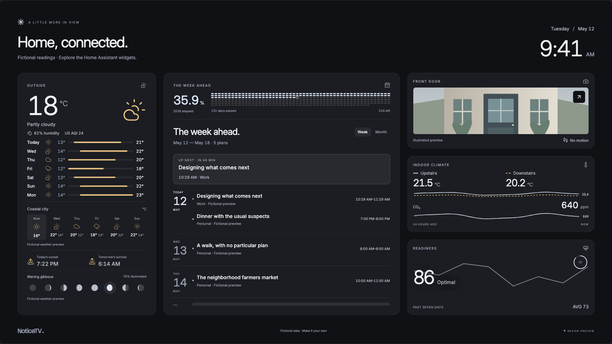
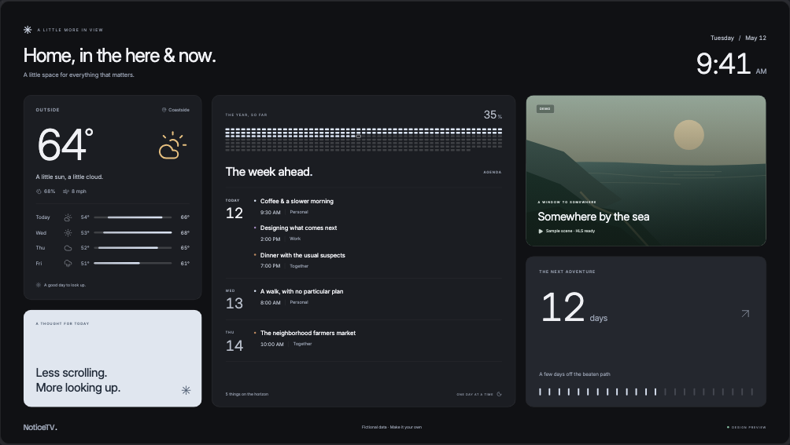
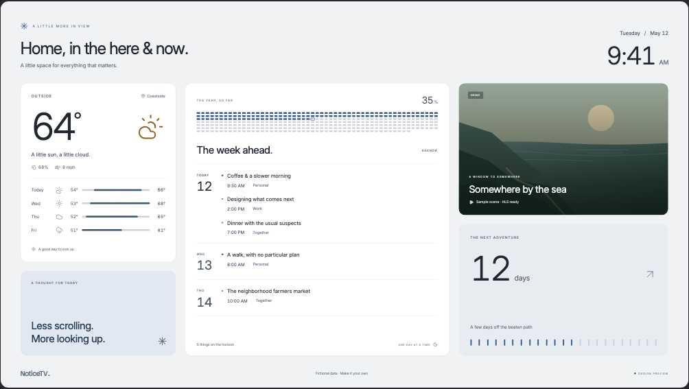
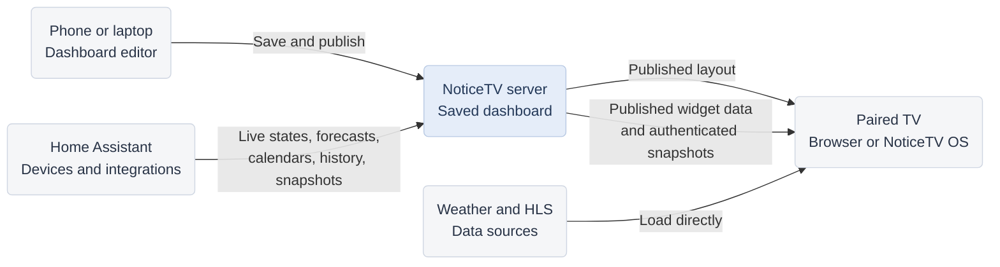
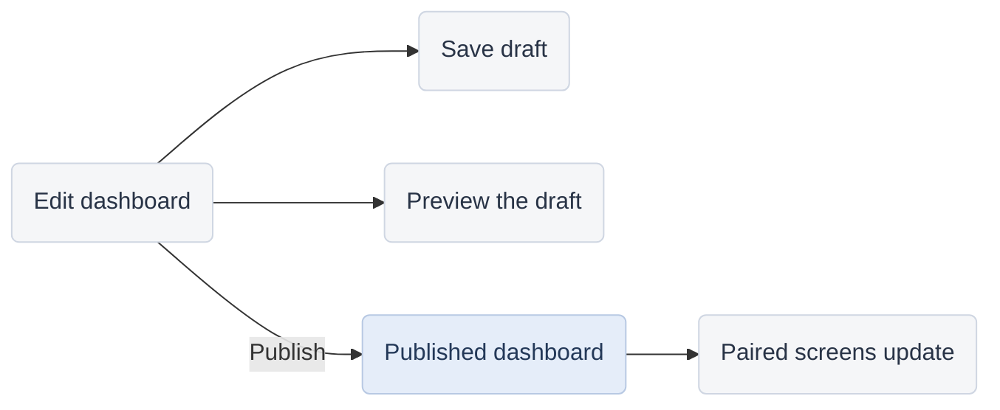
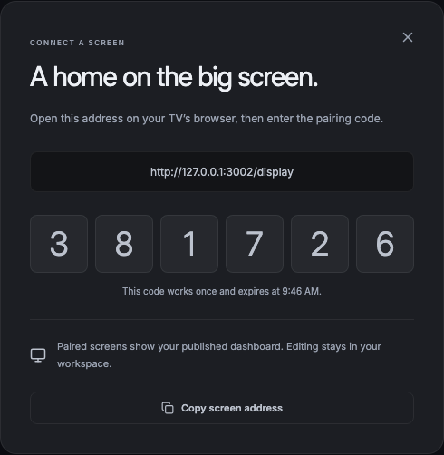
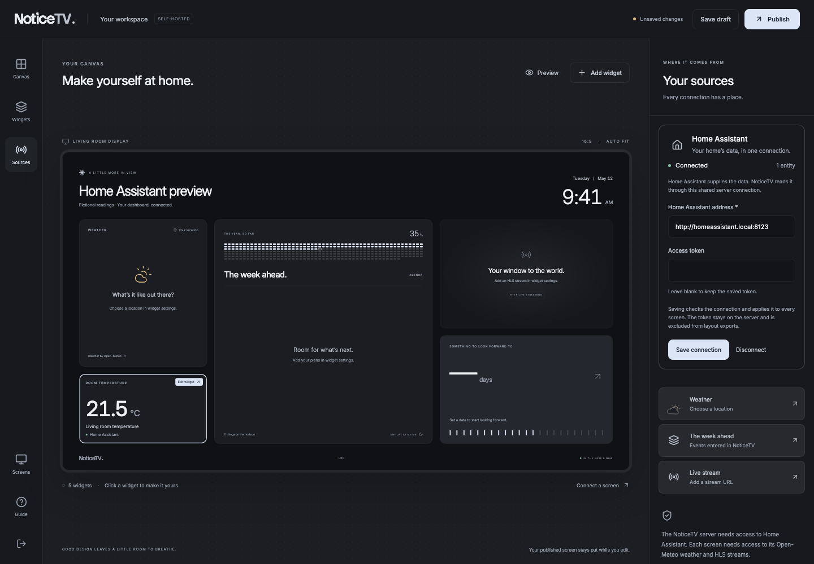

# NoticeTV

**A little more in view.**

A self-hosted dashboard for the screen in your room. Bring together the weather, your plans,
live video, and the things worth looking up for. Configure it from your phone or laptop,
then publish it to your TV.

[](docs/images/noticetv-dashboard.png)

_Screenshots use fictional demo data. The stream tile is an illustration; configured HLS streams play video._

[Try it locally](#try-it-locally) · [Hosting guide](app/README.md) · [Install NoticeTV OS](docs/operating-system.md) · [Contribute](CONTRIBUTING.md)

## Make it your own

Choose widgets, connect their sources, and arrange the view. Change sizes, reorder widgets,
and preview the whole screen before publishing. Export a layout to keep it or share it with a friend.

[](docs/images/noticetv-editor.png)

| Widget          | What it brings to the screen                                                                                                             |
| --------------- | ---------------------------------------------------------------------------------------------------------------------------------------- |
| **Weather**     | Current conditions and a five-day forecast from [Open-Meteo](https://open-meteo.com/), with city search and Celsius/Fahrenheit settings. |
| **Home Assistant** | Live sensor readings and entity status through one shared connection, with searchable entity selection and outage indicators. |
| **Home weather** | HA forecasts and outdoor sensors, humidity, US AQI, a second location, sun times, and moon phases. |
| **Connected calendar** | HA calendars, week/month views, source colors and filters, event details, and meeting reminders. |
| **Indoor climate** | Measured room temperatures and CO₂ with 24-hour recorder history. |
| **Readiness** | A 0–100 score, seven-day trend, and average from HA. |
| **Home status & camera** | Contact and motion status, plus authenticated snapshots with update times and outage indicators. |
| **Live video**  | HLS `.m3u8` streams, muted autoplay, fit/fill sizing, and recovery after playback interruptions.                                         |
| **Agenda**      | Plans you enter in NoticeTV, a date rail, and a day-by-day view of the year's progress.                                                  |
| **Note**        | Plain text for reminders, a message, or a thought for the day.                                                                           |
| **Countdown**   | The days remaining until something you're looking forward to.                                                                            |
| **World clock** | Another time zone, using your preferred 12- or 24-hour clock.                                                                            |

[See the widget collection](docs/images/noticetv-widgets.png) · [See the phone editor](docs/images/noticetv-editor-phone.png)

HLS streams must be reachable from the screen and permit browser playback from your dashboard's
address. Media plays directly in the browser; NoticeTV does not proxy or transcode it.

**Home Assistant supplies the integrations.** Open **Add widget → Use Home layout** for weather,
calendar, camera, climate, and readiness arranged together. Choose your HA entities in each card;
the preset starts with empty source selections. Enable **Allow display interactions** to change
calendar views, read event details, and enlarge snapshots on a paired screen.

[](docs/images/noticetv-home-widgets.png)

Explore the fictional [Home preview](http://localhost:3000/demo?home) on your local server, or see
[the editor](docs/images/noticetv-home-widgets-editor.png) and
[month view](docs/images/noticetv-home-widgets-month.png).

## Find your theme

Five palettes cover the whole dashboard: text, cards, notes, charts, and display background.
The editor stays neutral while you choose. Graphite is the default; cursor hiding is a separate
display setting and is off by default.

| Graphite · neutral charcoal                                                                                          | Paper · light surfaces                                                                                      |
| -------------------------------------------------------------------------------------------------------------------- | ----------------------------------------------------------------------------------------------------------- |
| [](docs/images/noticetv-theme-graphite.png) | [](docs/images/noticetv-theme-paper.png) |

Also available: [Midnight](docs/images/noticetv-theme-midnight.png) for deep navy,
[Ember](docs/images/noticetv-theme-ember.png) for warm charcoal and copper, and
[Moss](docs/images/noticetv-theme-moss.png) for earthy greens.

## How it fits together

Run one NoticeTV server on your own machine. Open its editor on your phone or laptop and its
display page on the TV. The server stores the dashboard and supplies selected Home Assistant
entity values. Each browser loads standalone weather and HLS media directly from its sources.



The dashboard works in a browser independently of the operating system. **NoticeTV OS** is the
appliance option: it turns a mini PC into a display that boots straight into your dashboard and
recovers from browser and network problems.

## From draft to display

1. **Build the view.** Choose widgets, sources, a layout, and a theme.
2. **Preview or save a draft.** Keep working without changing the published screen.
3. **Publish.** Connected screens pick up the new view within ten seconds.
4. **Connect a screen.** Open your server's `/display` page on the TV and enter the code from
   **Connect a screen** in the editor. Pairing can happen before or after the first publication.



Editing requires the server's editor key. A pairing code gives a screen viewing access to the
published dashboard. Codes work once and expire after five minutes. Use the address and code
shown by your own server.



The running display retains its last published layout during a server interruption and retries
the connection. Starting or reloading a display still requires the server.

## Try it locally

Requires **Node.js 22.12 or newer** and npm. From a checkout of this repository:

```sh
npm --prefix app ci
npm --prefix app run dev
```

Open **http://localhost:3000/demo** to explore the editor and sample widgets. The demo is temporary;
use **Export layout** to keep a configuration you make there.

To save a real dashboard, open **http://localhost:3000/**. In a second terminal, get the editor key:

```sh
npm --prefix app run access-key
```

Enter that key in the editor, connect your sources, and publish.

For Home Assistant, open **Sources**, connect your HA address with a long-lived access token,
then add a **Home Assistant** widget and choose an entity. Credentials stay on the server;
paired screens receive only selected values from the published dashboard. See the
[Home Assistant setup guide](app/README.md#home-assistant) for connection and outage behavior.

[](docs/images/noticetv-home-assistant.png)

The default server accepts connections from this computer. Before connecting a TV or phone,
configure its network address using the [hosting guide](app/README.md#access-from-another-device).
The guide also covers [Docker](app/README.md#docker), HTTPS, persistent storage, and backups.

## Add the TV appliance

NoticeTV OS runs on an Intel or AMD mini PC connected to a TV. It starts Chromium full screen,
recovers from browser and network problems, and installs Linux security updates. It can show
a NoticeTV dashboard or any other web page.

**The app and OS are installed separately.** The OS image does not currently bundle the dashboard
server. Install the server on a machine of your choice, then point the display at its `/display` page.

See the **[OS installation guide](docs/operating-system.md)** for the USB installer, hardware
requirements, and appliance settings. Installing the OS erases the selected drive.

## Current scope

This is early software with one dashboard per server and multiple paired screens. Real dashboards
start with empty source connections. HA widgets support live states, forecasts, calendars, recorder
history, and camera snapshots. Live WebRTC/go2rtc playback, the news header, market ticker, device
controls, and the original dashboard’s four-column layout are not included yet. The standalone
Agenda widget still accepts manually entered events.

## Contributing

Read **[CONTRIBUTING.md](CONTRIBUTING.md)** for the development workflow and **[AGENTS.md](AGENTS.md)**
for repository conventions. The [dashboard guide](app/README.md) describes the application structure,
configuration, and checks. Tests use local fixtures rather than real homes, cameras, or live services.

The screenshots are captured from the running app. See **[visual asset sources](docs/images/README.md)**
for the capture command and diagram sources.

## License

NoticeTV is free and open source under the **[GNU AGPL v3](LICENSE)**. Fonts and dependencies retain
their respective licenses; see [third-party notices](app/THIRD_PARTY_NOTICES.md).
