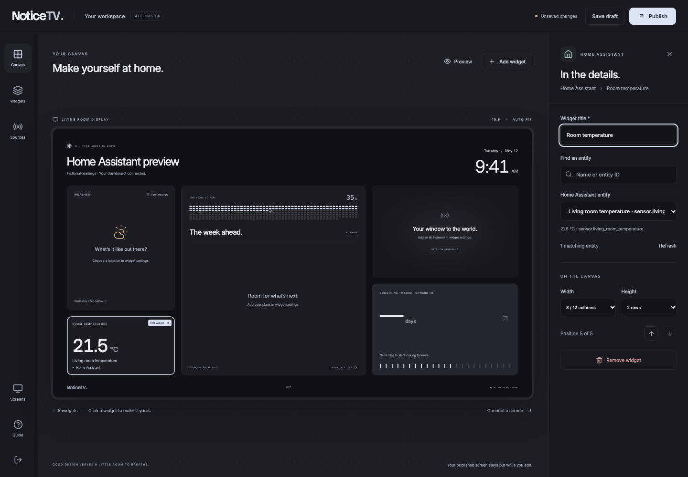

# NoticeTV dashboard

A browser editor, a passive TV display, and a small Node.js server. The application runs
independently of NoticeTV OS and does not require Home Assistant.

## Development

Use Node.js 22.12 or newer. Run these commands from `app/`:

```sh
npm ci
npm run dev
```

Visit `http://localhost:3000/demo` for the fictional workspace, or `/` for your editor.
In a second terminal, `npm run access-key` prints the editor key. It is created automatically
when the server starts, stored outside source control, and never sent to a display.

`npm run dev` listens on `0.0.0.0`. To open it from another device, set the address that
both browsers will use before starting it:

```sh
NOTICETV_ORIGIN="http://YOUR_LAN_IP:3000" npm run dev
```

Replace `YOUR_LAN_IP` with your computer's LAN IP, then open that address on both
devices. Set `NOTICETV_HOST=127.0.0.1` to restrict development to this computer.

The demo is temporary. Its Save and Publish buttons explain how to open a real workspace;
Export layout downloads the current demo configuration.

## Build and run

```sh
npm run build
npm start
```

The production server serves the built frontend and API on the same origin. It does not need
Vite, TypeScript, or tsx at runtime. `npm run access-key` also works after development dependencies
have been removed.

## Docker

From `app/`:

```sh
docker compose up --build -d
docker compose exec noticetv npm run access-key
```

Open `http://localhost:3000/`. Configuration and the editor key live in the `dashboard-data`
volume, which survives container replacement. The container runs as an unprivileged user.
Back up that volume to preserve both your dashboard and access.

### Access from another device

The built server defaults to a local listener; development listens on all interfaces. For a
home-network Docker instance, copy `.env.example` to
`.env` and set the address that **both the editor and every screen** will use:

```dotenv
NOTICETV_ORIGIN=http://noticetv.local:3000
NOTICETV_BIND_ADDRESS=0.0.0.0
NOTICETV_SECURE_COOKIES=0
```

`noticetv.local` is an example; configure a hostname that resolves to your server. Restart
Compose after changing these values. For npm rather than Docker, export `NOTICETV_ORIGIN`
and `NOTICETV_HOST=0.0.0.0` in the server's shell. npm does not load `.env` files.

The server accepts only its configured Host and Origin. An alternate hostname or IP is
intentionally rejected. This prevents another website from using the local editor through a
forged origin or DNS rebinding.

For access over the internet, serve the app through an HTTPS reverse proxy, set
`NOTICETV_ORIGIN` to its public HTTPS origin and `NOTICETV_SECURE_COOKIES=1`, and preserve the
original Host header. The server does not trust forwarded authentication or proxy IP headers.
HTTP sources may be blocked as mixed content on an HTTPS dashboard; use HTTPS sources there.

### Configuration

| Variable                  | Default                                   | Meaning                                                       |
| ------------------------- | ----------------------------------------- | ------------------------------------------------------------- |
| `PORT`                    | `3000`                                    | Server port.                                                  |
| `NOTICETV_HOST`           | Dev: `0.0.0.0`; built server: `127.0.0.1` | Listener address; Docker uses `0.0.0.0` inside its container. |
| `NOTICETV_ORIGIN`         | `http://localhost:3000`                   | The single browser origin accepted by the server.             |
| `NOTICETV_DATA_DIR`       | `app/.data`                               | Dashboard and key directory; Docker uses `/data`.             |
| `NOTICETV_EDITOR_KEY`     | Generated file                            | Override with a secret of 24 to 256 characters.               |
| `NOTICETV_SECURE_COOKIES` | `0`                                       | Use `1` when the browser connects over HTTPS.                 |

Relative data paths resolve from the working directory. Run one server process per data directory.
Keep credentials in environment configuration or the protected data directory.

## From draft to display

1. Choose a widget to configure it. **Add widget** opens the collection. The Widgets panel supports
   dragging; widget settings also provide keyboard-accessible move controls.
2. **Save draft** stores work without changing the display. **Preview** shows the current draft.
   **Publish** validates and stores both the draft and the display version.
3. Choose **Connect a screen**. Open the displayed `/display` address on the TV and enter its code.

The cursor is visible by default. In dashboard settings, turn on **Hide cursor on display** to
hide it in the display and preview. Publish the setting to apply it to connected screens;
the editor keeps its cursor visible. Older layouts also default to showing the cursor.

### Themes

Choose a theme in dashboard settings. The canvas and display preview update immediately. Save it
as a draft or publish it to connected screens, just like a layout change. Theme choices are also
included in layout imports and exports.

| Theme                                                  | Appearance                         |
| ------------------------------------------------------ | ---------------------------------- |
| [Graphite](../docs/images/noticetv-theme-graphite.png) | Neutral charcoal; the default.     |
| [Midnight](../docs/images/noticetv-theme-midnight.png) | Deep navy with blue accents.       |
| [Paper](../docs/images/noticetv-theme-paper.png)       | Light surfaces with dark text.     |
| [Ember](../docs/images/noticetv-theme-ember.png)       | Warm charcoal with copper accents. |
| [Moss](../docs/images/noticetv-theme-moss.png)         | Earthy greens.                     |

Themes apply to widget surfaces, text, notes, charts, and the area surrounding the display.
Video content retains its original colors. The editor, sign-in page, and dialogs use neutral
colors independently of the dashboard. Layouts saved before themes existed default to Graphite.
Palette definitions live in `shared/themes.ts`; dashboard CSS uses their semantic color variables.

Pairing codes expire after five minutes and work once. A new code invalidates the previous code.
A display session can read only the published dashboard, never drafts or editing endpoints.
Editor sessions last twelve hours. Display sessions last thirty days and renew daily while the
screen is running, so an active display stays paired.

Changing the editor key invalidates all sessions after a server restart. With the default file
key, stop the server and move `editor-key` to a protected backup location, then start the server
to create a new key and pair displays again. Restore data-directory backups while the server is
stopped; the directory is the source of truth, not browser storage.

Concurrent editors use a revision check: a stale save is rejected rather than overwriting newer
work. Export your layout before reloading a conflicting edit to retain it. Layout exports contain
source addresses and event content; they are configuration backups.

## Sources and playback

- **Home Assistant:** one server-side connection supplies live entity states to Home Assistant
  widgets and the richer weather, calendar, climate, readiness, status, and camera cards. Setup,
  entity selection, permissions, and outage behavior are described below.
- **Weather:** city search uses Open-Meteo geocoding. Forecasts load directly from Open-Meteo on
  each screen every fifteen minutes while visible, and on reconnection. The configured approximate
  city coordinates are sent to Open-Meteo. Attribution is shown. Consult
  [Open-Meteo's terms](https://open-meteo.com/en/terms) for your intended usage.
  In the widget settings, choose a **Current temperature sensor** to use an HA sensor for the
  large current-temperature reading while keeping Open-Meteo conditions and forecasts. Choose
  **Use Open-Meteo temperature** to return to the provider reading. Sensors reporting °C, °F,
  or K follow the dashboard's temperature units. An unavailable or unsupported reading shows
  a dash; interrupted connections retain the last known reading with its update time. The sensor
  can display its temperature before a forecast location is selected and during forecast outages.
  [See the weather sensor selector](../docs/images/noticetv-weather-sensor.png).
- **HLS:** provide an HTTP or HTTPS playlist URL that permits anonymous browser playback from the
  dashboard's origin, including its segments and keys. Streams start muted, use native HLS or
  hls.js, and retry fatal errors and stalled playback with delays up to thirty seconds. Hidden
  displays suspend playback. The server neither proxies nor transcodes media.
- **Agenda:** events are entered in the editor and interpreted in the dashboard's time zone.
  Earlier days are hidden. This is not a connected calendar integration.
- **Countdown:** enter the target in the editor device's time zone; it is saved as an absolute
  timestamp. The display shows complete remaining twenty-four-hour periods, clamped to zero.
- **World clock:** uses the widget's IANA time zone and the dashboard's 12/24-hour preference.
- **Notes:** plain text, with line breaks. HTML is rendered as text.

The TV view scales a 1600×900 canvas to fit its viewport without clipping. Widget widths use a
twelve-column grid. Taller layouts fit into the same canvas; preview before publishing.
Screens retain the running layout during server outages and retry every ten seconds. A cold start
still requires the server. Live WebRTC/go2rtc playback and HA device controls are not implemented.
The OS image does not automatically install the app.

### Home Assistant

Home Assistant owns your devices and third-party integrations. NoticeTV reads their states,
forecasts, calendars, recorder history, and camera snapshots through one shared connection;
each screen connects only to NoticeTV for this data.

1. In Home Assistant, create a **long-lived access token** in your account profile.
   Use an account with access to the entities you want to display.
2. In NoticeTV, open **Sources**, enter the **Home Assistant address** and **Access token**, and
   choose **Connect Home Assistant**. Use the address reachable from the NoticeTV server, without
   a path. Saving verifies authentication, state access, and the live subscription before replacing
   a saved connection. A failed replacement preserves the working connection.
3. Add a **Home Assistant** widget, search by entity name or ID, and choose an entity. The widget
   shows its current state and HA-provided unit. Save a draft or publish it as usual.

[](../docs/images/noticetv-home-assistant-widget.png)

[See connection setup on a phone](../docs/images/noticetv-home-assistant-phone.png).

The server uses HA's [WebSocket API](https://contributors.home-assistant.io/core/internals/websocket-api/)
through the official JavaScript client for authenticated reads and state-change subscriptions.
There are no device-control endpoints, arbitrary HA command forwarding, or separate integrations
with the services behind HA. The initial connection check is bounded to ten seconds. A heartbeat
detects a silent connection failure; disconnected connections retry automatically. Revoked tokens
require a new token in Sources.

Visible widgets request their selected values from NoticeTV every two seconds. During an outage,
running screens retain readings and label them **Last known reading**, with the entity's update
time. HA states of `unknown` or `unavailable` show an unavailable reading. Reconnection replaces
the cache with a full snapshot, including entity removals. A server restart needs HA to obtain
fresh readings; readings are not persisted to disk.

The connection is installation-wide and takes effect when saved, independently of dashboard
publication. Tokens live in `home-assistant.json` in the protected data directory, with mode
`0600`; they are not encrypted at rest. Treat data-directory backups as credentials. The token
is never returned to browsers or included in layout exports. Changing the HA address requires
entering its token again. **Disconnect** removes the saved credentials and clears cached readings
for all screens without deleting widget selections.

Only editors can change the connection or browse entities. Paired screens can request only
entities used by the **published** dashboard, never selections that exist only in a draft.
Responses contain the selected state, name, unit, device class, and update time. Raw entity
attribute objects, camera tokens, private endpoint URLs, and HA credentials are not forwarded. Rich widgets expose
only the fields they render; published calendars include event details and locations, and a
published camera makes its snapshots available to paired screens. Layout exports
include entity IDs; importing a layout requires setting up its HA connection on the destination
server.

If Docker cannot resolve `homeassistant.local`, use an address that resolves inside the container.
HTTPS connections use normal certificate validation; configure a trusted certificate rather than
disabling verification.

### Rich Home widgets

Choose **Add widget → Use Home layout** to preview the five-card preset, then **Replace draft
layout**. The action replaces the draft's widgets; publication remains a separate step. All source
choices start empty. Configure your dashboard's time zone and temperature units, then choose the
HA entities in each widget. The connection itself stays in Sources.

| Widget                 | Sources and behavior                                                                                                                                                                                                                                                                                                                                                                                                                                                                                                                             |
| ---------------------- | ------------------------------------------------------------------------------------------------------------------------------------------------------------------------------------------------------------------------------------------------------------------------------------------------------------------------------------------------------------------------------------------------------------------------------------------------------------------------------------------------------------------------------------------------ |
| **Home weather**       | Choose a `weather` entity for conditions and daily forecasts. HA hourly or twice-daily forecasts are grouped into local days. Selected outdoor temperature/humidity sensors override the weather entity's current values when available. US AQI uses a selected sensor. For the second location, search for a town/city with Open-Meteo or choose another HA weather entity. The strip shows current conditions and five future days. Sun times use HA's home location and selected sun entity; moon phases are calculated locally with SunCalc. |
| **Connected calendar** | Select up to eight HA calendars, their names/colors, and which should produce meeting reminders. Reminders cover the next three hours and exclude all-day events and calendars named as TV schedules. Filters cover finished/declined/duplicate/multi-day events and comma-separated hidden-title phrases. All-day end dates are exclusive and respect the dashboard time zone across daylight-saving changes.                                                                                                                                   |
| **Indoor climate**     | Select up to two temperature sensors or thermostat entities, plus a CO₂ sensor. Thermostats use measured `current_temperature`, rather than their target setting. The charts show 24 hours of recorder history, including attribute-only changes. The second temperature has a dashed line; unavailable readings leave gaps.                                                                                                                                                                                                                     |
| **Readiness**          | Select a 0–100 score entity. The card shows the current score, seven-day recorder trend, and average of available recorded readings. Missing or out-of-range scores show unavailable. No Oura account or provider credentials are needed in NoticeTV.                                                                                                                                                                                                                                                                                            |
| **Home status**        | Select up to twelve binary contact sensors (`on` means open) and a motion sensor. Unavailable or missing contacts are counted separately and never reported as closed.                                                                                                                                                                                                                                                                                                                                                                           |
| **Camera**             | Select an HA camera and a motion sensor. Authenticated snapshots refresh every 20 seconds while visible. The update time records when NoticeTV fetched the image; it does not establish the camera frame's original capture time. This is a snapshot widget, separate from the anonymous HLS stream widget.                                                                                                                                                                                                                                      |

Temperature readings and histories support HA's Celsius, Fahrenheit, and Kelvin units, displayed
in the dashboard's Celsius/Fahrenheit preference. Unknown temperature units remain unavailable.
CO₂ values retain their HA units; threshold colors apply only to ppm readings.

In Home weather settings, **Second location source → Search for a location** reveals a city
search. Select a result to save its name and coordinates in the layout. Open-Meteo requests load
directly from the screen every fifteen minutes, using that location's forecast dates and the
dashboard's temperature units. The approximate city coordinates are sent to Open-Meteo. Existing
second-location HA entity selections keep working; choose **Off** to hide the strip.
[See the second-location configuration](../docs/images/noticetv-second-location.png).

For multiple HA calendars, add a **Connected calendar** widget (its default title is **The week
ahead**). Choose each entity with **Add calendar**; up to eight calendars share the view, with
independent names, colors, and reminder settings. The separate **Agenda** widget accepts manually
entered events.

Rich data refreshes on visible screens every five seconds. Forecasts are shared and cached for
fifteen minutes; calendar and recorder requests for five minutes; snapshots for twenty seconds.
Failed reads retain available cached data with an interruption warning and last-update time.
Failures retry after a thirty-second backoff. Requests have ten-second timeouts and an eight-MiB
REST response limit. Snapshots accept JPEG, PNG, and WebP, and authenticated requests never follow
redirects. Source caches are cleared when the connection changes or is disconnected.

The default TV view is passive. Enable **Allow display interactions** in dashboard settings,
then publish to allow calendar view changes, day selection, event details, and enlarged snapshots.
These interactions do not edit the dashboard or control HA devices. Enlarging a snapshot reuses
its existing image and refresh cycle, and shows the full image. The dense Home preset uses Fill
for camera thumbnails; choose Fit in camera settings to preserve the full frame within its card.

Try `/demo?home` for the fictional Home layout and `/demo?home&cameras` for contact status and
camera interaction previews. Their readings and illustrated camera are local demo assets; they
never contact HA or an external source.

The server's widget endpoints separate unsaved editor previews from display reads. A paired
screen requests a published widget ID; all entities, calendar ranges, history windows, units,
and time zones are resolved from the saved publication. Client-provided source overrides cannot
change a display's selection. The server provides specific read paths, never a general HA proxy.

## Project structure

| Path                       | Responsibility                                                                           |
| -------------------------- | ---------------------------------------------------------------------------------------- |
| `shared/dashboard.ts`      | Versioned document schema, defaults, fictional demo, grid placement.                     |
| `server/store.ts`          | Serialized revision checks and atomic file replacement.                                  |
| `server/auth.ts`           | Editor key and signed role-limited cookies.                                              |
| `server/home-assistant.ts` | Shared HA connection, protected credentials, recovery, and safe entity projection.       |
| `server/ha-widgets.ts`     | Typed rich-widget reads, shared caches, and source interruption handling.                |
| `shared/rich-widgets.ts`   | Rich widget schemas, explicit source selections, and safe payload types.                 |
| `shared/ha-data.ts`        | Calendar dates/filters, forecast grouping, unit conversion, and recorder interpretation. |
| `src/rich/`                | Weather, calendar, sensor, and camera views with shared read-only dialogs.               |
| `shared/home-assistant.ts` | Connection validation and browser-safe data contracts.                                   |
| `src/HomeAssistant.tsx`    | Connection setup, searchable entity selection, and live state widget.                    |
| `server/app.ts`            | Validated API, pairing, host/origin checks, request limits.                              |
| `server/index.ts`          | Development middleware or production static serving.                                     |
| `src/App.tsx`              | Session routing to the editor, sign-in, or display.                                      |
| `src/Editor.tsx`           | Draft editing, publishing, pairing, import/export.                                       |
| `src/Display.tsx`          | Published dashboard synchronization and outage retention.                                |
| `src/Login.tsx`            | Editor sign-in and display pairing.                                                      |
| `src/ui.tsx`               | Shared dialogs, branding, and scaled display canvas.                                     |
| `src/Inspector.tsx`        | Dashboard and widget settings, location search.                                          |
| `src/Dashboard.tsx`        | Display layout and widget presentation.                                                  |
| `src/Video.tsx`            | HLS lifecycle, visibility, autoplay, and recovery.                                       |
| `src/use-weather.ts`       | Bounded public requests and stale-data retention.                                        |

Browser and server validate the same document. A malformed existing file stops startup rather
than silently replacing it. Publication becomes visible in memory only after the file has been
written, synced, and atomically renamed.

## Verification

```sh
npm run format:check
npm test
npm run build
npx playwright install chromium
npm run test:browser
```

Browser tests run against the production build on loopback port 3001. They cover desktop/phone
rendering, publication, pairing permissions, weather configuration, HLS playback, and recovery
after a media error. Media and weather are fixtures; all other external browser requests are
blocked. No test connects to a real installation.

To use an installed Google Chrome instead of downloading Playwright Chromium:

```sh
PLAYWRIGHT_CHANNEL=chrome npm run test:browser
```

Test screenshots and traces are written to ignored `test-results/`. Run `npm run screenshots`
after building the app to refresh the public documentation images from an isolated local server.
See [visual asset sources](../docs/images/README.md), [fixture provenance](tests/fixtures/README.md),
and [third-party notices](THIRD_PARTY_NOTICES.md).
