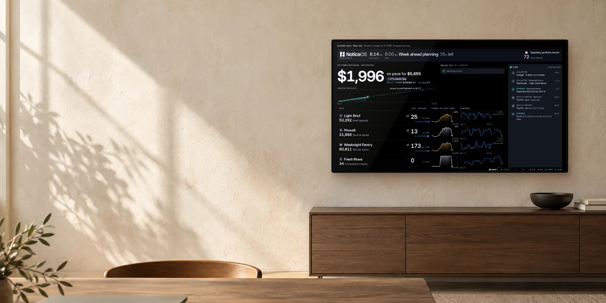
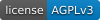
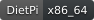
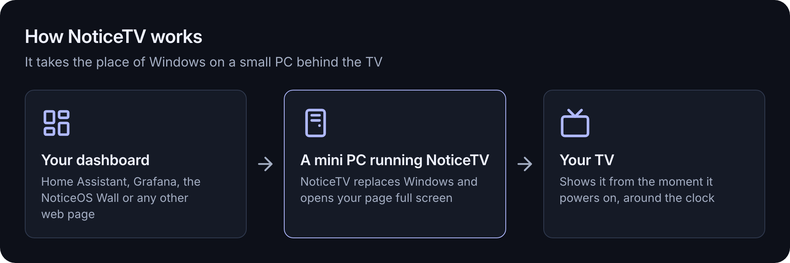
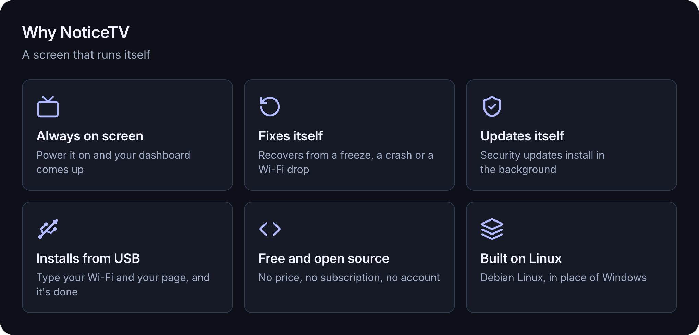
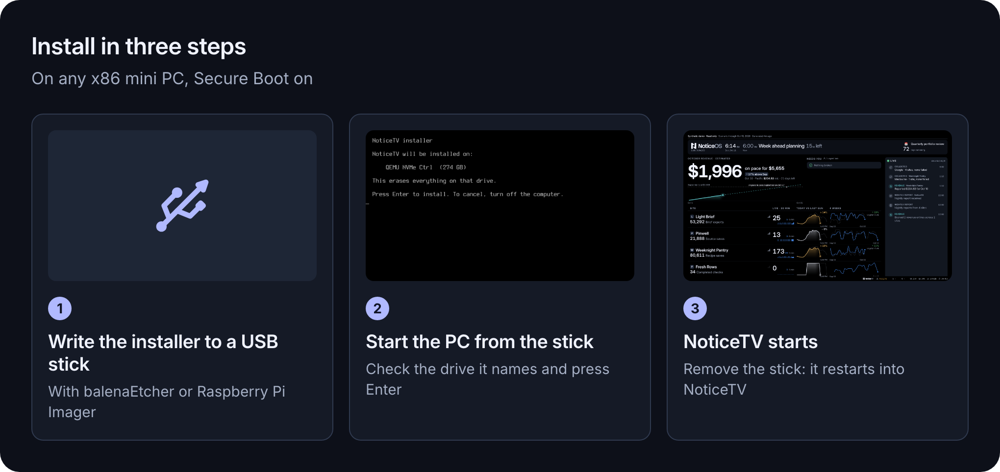
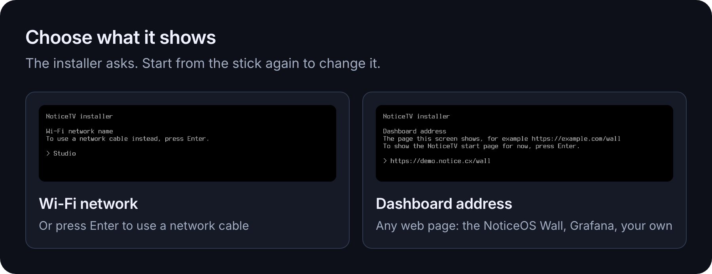
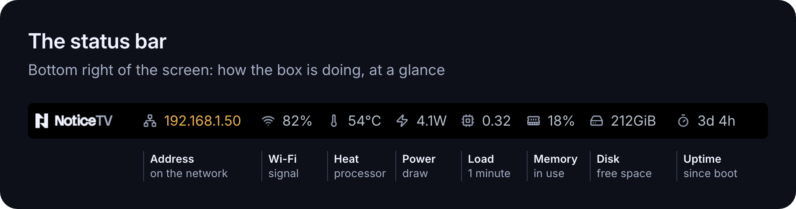
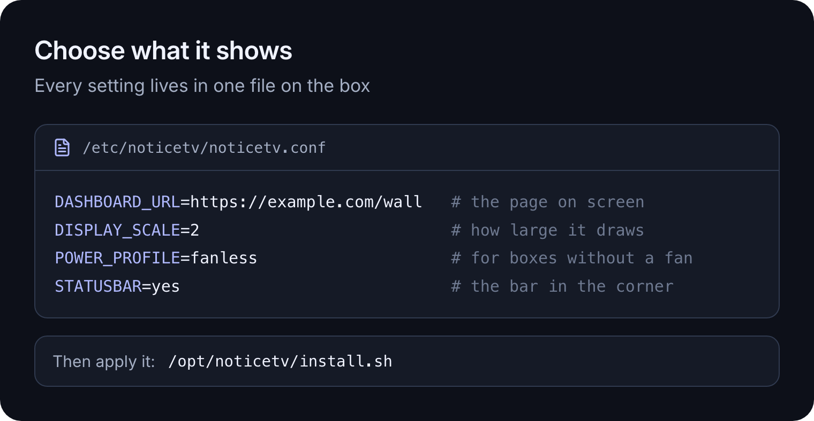

# NoticeTV OS

For the browser dashboard and editor, see the [main README](../README.md).

[](images/noticetv-hero.jpg)

## Your dashboard. On the wall.

**NoticeTV turns a small PC behind your TV into a screen that shows your dashboard, around the
clock.**

NoticeTV is a complete operating system, built on Linux, that you install on a mini PC in place
of Windows. Connect the PC to your TV, tell the installer which web page to show (your Home
Assistant or Grafana dashboard, the NoticeOS Wall or any other page), and from then on the TV
starts straight into that page every time it is switched on. NoticeTV keeps it there:
it recovers from problems on its own and installs its security updates in the background.

It is free and open source.

[](../LICENSE)
[](https://www.debian.org/)
[](https://dietpi.com/)
[](https://www.chromium.org/)
[](building.md#the-installer)



## Why NoticeTV



- **Always on screen.** Switch the PC on and your dashboard comes up full screen, after the
  NoticeTV start-up screen. No desktop, no sign-in, nothing to click.
- **Fixes itself.** If the PC freezes, it restarts. If the browser closes, it reopens. If your
  dashboard comes up blank, say because its server was restarting, it reloads it. If the Wi-Fi
  drops, it reconnects.
- **Updates itself.** Security updates for Linux and the browser download and install in the
  background, every day. When one needs a restart, the PC restarts at 4:30 in the morning.
- **Installs from a USB stick.** The installer asks for your Wi-Fi network and your dashboard's
  address, and does the rest. Secure Boot can stay on.
- **Free and open source.** Anyone can read, check and
  improve the code, which is published under the GNU AGPL license.
- **Built on Linux.** NoticeTV is built on [Debian](https://www.debian.org), one of the oldest
  and most widely used versions of Linux, through [DietPi](https://dietpi.com), a lightweight
  edition of it. You never deal with Linux itself: the PC goes straight to your dashboard.

## Questions

### Is NoticeTV OS an app?

No. NoticeTV is the operating system: it runs the whole PC, the way Windows did before. It opens
your dashboard full screen in Chromium, the open-source browser that Google Chrome is built on.

### What happens to Windows?

Installing NoticeTV erases the PC's drive. Windows, and every file on the drive, are replaced by
NoticeTV. Copy anything you want to keep before you start.

### What can it show?

Any web page: a Home Assistant or Grafana dashboard, the NoticeOS Wall, a status page or your own
site. Choose an address that opens without a sign-in screen, since nobody signs in at the TV.

### Do I need NoticeOS?

No. [NoticeOS](https://github.com/notice-cx/NoticeOS) is a separate project that makes the Wall
dashboard in the picture above. NoticeTV shows it, or any other page.

## What you need

- **A mini PC with an Intel or AMD processor**, the kind sold with Windows, with a drive of 8 GB
  or more. [docs/hardware.md](hardware.md) lists the PCs NoticeTV has run on.
- **A TV or monitor** to connect it to.
- **Wi-Fi or a network cable.**
- **A USB stick of 2 GB or more and a USB keyboard**, for the installation.
- **The web address of your dashboard.**

## Install



> [!WARNING]
> Installing NoticeTV erases the PC's drive, including Windows and all files on it.

1. Download `noticetv-installer-<version>-x86_64.img` from the latest
   [release](https://github.com/notice-cx/NoticeTV/releases) and write it to the USB stick with
   [balenaEtcher](https://etcher.balena.io) or Raspberry Pi Imager.
2. Plug the stick and the keyboard into the PC, switch it on and choose the USB stick in its boot
   menu (often F7, F11, F12 or Esc while it starts). Check the drive the installer names and press
   Enter. Type your Wi-Fi network and its password (or press Enter to use a network cable), then
   your dashboard's address.
3. When the installer says it is done, remove the stick. The PC restarts into NoticeTV and shows
   your dashboard.

**So the screen comes back after a power cut**, set the PC to switch itself on when power
returns: in its firmware settings (the BIOS, often opened with Del or F2 while it starts), set
*Restore on AC Power Loss*, or similar, to *Power On*.

## Choose what it shows



The installer asks for your Wi-Fi and your dashboard. To change either later, start the PC from
the installer stick again and choose **Change its Wi-Fi and dashboard**: everything else on the
PC stays as it is.

## The status bar



A slim bar along the bottom of the screen shows how the PC is doing: its network address, Wi-Fi
signal, temperature, power use, load, memory, free disk space and how long it has been running.

## Under the hood

For the technically curious:

- **NoticeTV OS** is a layer on [DietPi](https://dietpi.com) (Debian 13, x86_64): Chromium as a
  full-screen kiosk, a Plymouth boot screen in place of console text, and NoticeTV's own services.
- **Recovery**: a hardware watchdog reboots a frozen PC, the kernel reboots after a crash, the
  kiosk restarts if Chromium quits (and every night at 04:00), a page left blank for 2 minutes is
  reloaded (with growing pauses while it stays blank), and Wi-Fi reconnects after a real outage of
  about 90 seconds rather than on a single lost ping.
- **Logs** stay on disk, with a health line every minute, so a problem can be diagnosed after
  the fact: [docs/troubleshooting.md](troubleshooting.md).
- **Updates**: Debian's `unattended-upgrades` installs security updates daily and reboots at
  04:30 when one needs it.
- **No SSH server** in the image: an appliance on someone else's network listens for no logins.
- **Secure Boot**: the installer starts through Debian's signed shim, GRUB and kernel.
- **Fanless PCs**: a power profile caps the processor's power, so a passively cooled PC holds a
  steady temperature.
- **Tested before release**: every release's installer is tested end to end in a virtual machine
  with Secure Boot on. It installs NoticeTV on a blank drive, starts it, and checks the kiosk, the
  Wi-Fi and the dashboard. [docs/building.md](building.md) explains how the image and
  installer are built.

The release also has the **NoticeTV OS image** the installer writes,
`noticetv-os-<version>-x86_64.img.xz`, for writing to a drive directly.

### On a PC already running DietPi

With SSH enabled, from a computer with this repository:

```sh
scripts/install-over-ssh.sh root@<the PC's IP address>
ssh root@<the PC's IP address> reboot
```



Every setting is then in `/etc/noticetv/noticetv.conf`; run `/opt/noticetv/install.sh` there to
apply it. Each one, with its default, is in [os/noticetv.conf.example](../os/noticetv.conf.example).
`install.sh` is safe to run again at any time, for example after pulling a newer version.

## Status

NoticeTV is new. It runs the maintainer's own wall display around the clock. Tell us how it runs
on your PC in [Issues](https://github.com/notice-cx/NoticeTV/issues).

## License

NoticeTV is licensed under the [GNU AGPL v3](../LICENSE). The Stack Sans Notch and Inter fonts in
`brand/fonts` are licensed under the SIL Open Font License 1.1, and the
[Lucide](https://lucide.dev) icons in `brand/icons` under the ISC License. The hero's
photograph is from [notice.cx](https://www.notice.cx).
